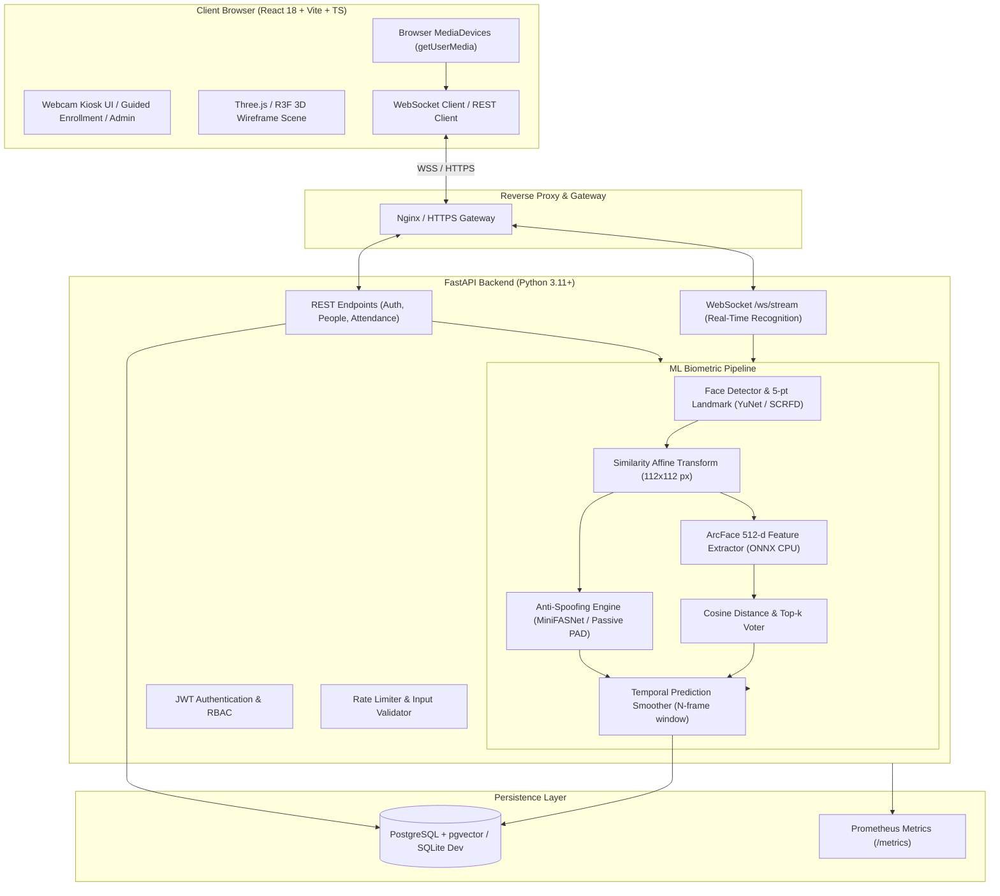
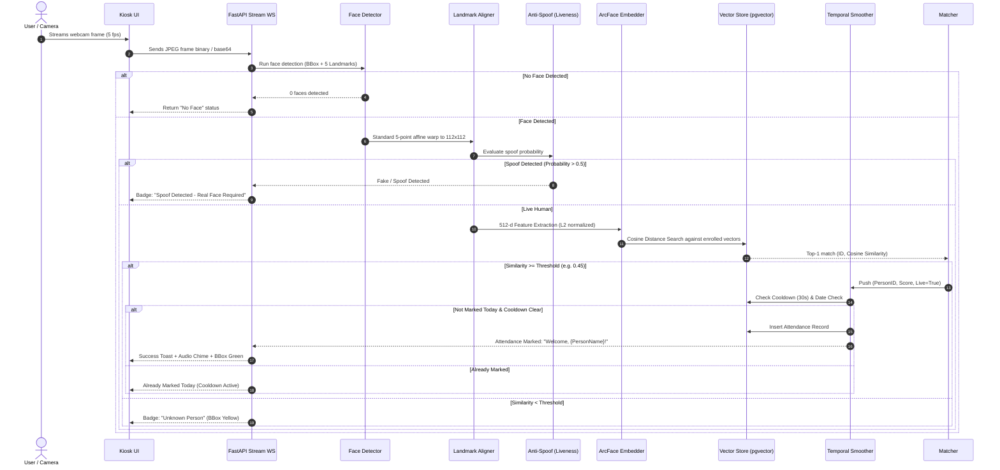

# Target System Architecture & Technical Specification

## 1. System Vision & Architecture Paradigm

The modernized Face Recognition Attendance System transitions from a legacy monolithic desktop script to an **open-set, cloud-ready, microservices-based biometric attendance platform**.

The core paradigm is **Deep Metric Learning (Detect -> Align -> Embed -> Match)**:
- **Zero Retraining Enrollment**: New individuals are enrolled dynamically by computing 512-dimensional L2-normalized feature vectors stored in a vector index (`pgvector` or `FAISS`).
- **Open-Set Identification & Rejection**: Cosine similarity against enrolled identities with mathematically calibrated confidence thresholds ($FAR=0.1\%$). Unknown faces are rejected reliably.
- **Biometric Anti-Spoofing**: Passive liveness detection + active blink/head-pose challenge prevents photo/video presentation attacks.
- **Full-Stack Decoupled Architecture**: High-performance FastAPI backend paired with a modern React + TypeScript + Three.js frontend.

---

## 2. High-Level Architecture Diagram

---

## 3. Machine Learning Pipeline: Detect -> Align -> Embed -> Match

---

## 4. Component Design Specifications

### 4.1 ML Biometric Engine (`/ml`)
1. **Face Detection & Alignment**:
   - Model: OpenCV YuNet / SCRFD with 5 facial landmarks (left eye, right eye, nose tip, left mouth corner, right mouth corner).
   - Alignment: 5-point similarity transformation warps the face into canonical 112x112 ArcFace coordinate space.
2. **ArcFace Embedding Generation**:
   - Deep residual backbone (ResNet50 / MobileFaceNet) pre-trained with Additive Angular Margin loss.
   - Generates $\mathbf{v} \in \mathbb{R}^{512}$ where $\|\mathbf{v}\|_2 = 1.0$.
   - Quantized to ONNX INT8 for CPU-optimized inference ($<150$ ms latency).
3. **Passive Liveness / Anti-Spoofing (PAD)**:
   - Evaluates texture, reflection, moiré patterns, and depth cues to distinguish genuine 3D facial skin from 2D printouts and high-definition screens.
4. **Matching & Calibration**:
   - Cosine Similarity: $\cos(\mathbf{u}, \mathbf{v}) = \mathbf{u} \cdot \mathbf{v}$.
   - Calibrated Operating Points:
     - High Security ($FAR = 0.1\%$): Cosine Threshold $\approx 0.50$
     - Balanced ($FAR = 1.0\%$): Cosine Threshold $\approx 0.42$

### 4.2 Backend Architecture (`/backend`)
- **Framework**: FastAPI (async Python 3.11+)
- **Authentication**: JWT tokens, argon2 password hashing, role-based access control (`admin`, `instructor`).
- **Database & Vector Search**:
  - Production: PostgreSQL 16 + `pgvector` extension for cosine distance index (`<->` operator).
  - Development / Fallback: SQLite with in-memory cosine ranking.
- **Endpoints**:
  - `POST /auth/login`, `POST /auth/register`
  - `GET /people`, `POST /people`, `POST /people/{id}/enroll`, `DELETE /people/{id}`
  - `POST /recognize`: Single frame recognition API.
  - `POST /attendance/mark`, `GET /attendance`, `GET /attendance/export.csv`, `GET /attendance/export.xlsx`
  - `WebSocket /ws/stream`: High-efficiency streaming webcam endpoint.
  - `GET /health`, `GET /metrics` (Prometheus), `GET /model/info`

### 4.3 Frontend Architecture (`/frontend`)
- **Stack**: React 18, Vite, TypeScript, TailwindCSS, Lucide-react, Canvas / WebGL.
- **3D Hero Visualizer**: Three.js + React Three Fiber interactive particle face-mesh responding to real-time kiosk state (Idle = floating cyan grid; Scanning = pulsing blue particles; Success = green burst; Unknown = yellow alert).
- **Core Views**:
  - **Live Kiosk**: Real-time webcam canvas feed with bounding box overlay, FPS indicator, liveness badge, audio chime.
  - **Guided Enrollment Wizard**: Step-by-step angle capture (Front, Left, Right) with live quality assessment (sharpness, size, illumination) and explicit consent confirmation.
  - **Admin Analytics Dashboard**: Daily attendance summary, Recharts visualizations, filtering, CSV/Excel downloads, and student/employee management.

### 4.4 DevOps & Deployment (`/deploy`, `.github/workflows`)
- **Docker Compose**: Orchestrates `api` (FastAPI), `db` (Postgres + pgvector), and `web` (React + Nginx).
- **Continuous Integration**: Ruff linting, mypy type verification, pytest execution with coverage check, and Docker build tests.
- **Zero-Cost Deployment Topology**:
  - Backend: Hugging Face Spaces (Docker SDK) or Render/Railway.
  - Database: Neon / Supabase serverless Postgres with pgvector.
  - Frontend: Vercel or Netlify with HTTPS (mandatory for `getUserMedia` camera permissions).
